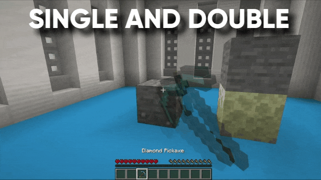

<p align="center">
 
</p>

<h1 align="center">KGenerators Regenerated</h1>

<p align="center">
  <a href="https://github.com/MaximumWoahverdrive/KGenerators/actions/workflows/gradle-build.yml"></a>
  <a href="https://github.com/MaximumWoahverdrive/KGenerators/releases"></a>
  
  
</p>

<p align="center">
  <b>Custom block generators for Spigot, Paper and Folia, from Minecraft 1.8.8 to 26.x.</br>
  Skyblock, survival, prison or anywhere else: simple and multi-purpose.</b>
</p>

<p align="center">
 
 
 
</p>

## About

KGenerators Regenerated continues [KGenerators](https://github.com/Kryniowesegryderiusz/KGenerators)
by Kryniowesegryderiusz, which was archived in October 2025. It is a drop-in replacement: the
plugin name, commands, permissions, configuration files, data folder and developer API are
unchanged, so an existing server keeps its generators when swapping the jar.

On top of the original it adds:

- **Folia** support
- **Minecraft 26.x** support, alongside every version back to 1.8.8
- Generators made of gravity blocks (sand, gravel, ...) no longer fall out of place
- Crop generators (`WHEAT`, `CARROT`, `POTATO`) work on 1.8-1.12 as well

## Download

Get the latest jar from [Releases](https://github.com/MaximumWoahverdrive/KGenerators/releases)
and put it in your server's `plugins/` folder. Java 8 or newer, whatever your Minecraft version
needs.

## Documentation

See [docs/](docs/README.md): commands and permissions, configuration, limits, supported plugins
and the developer API.

## Support

Report bugs and ask questions in [GitHub issues](https://github.com/MaximumWoahverdrive/KGenerators/issues).

## Building

```sh
gradle build
```

The plugin jar is written to `build/libs/`. Gradle downloads the JDKs it needs. Test servers for
each supported version run with `gradle runPaper1_8_8`, ... `runPaper1_21_11`, `runServer`
(Paper 26.3) and `runFolia`.

## Credits and license

KGenerators was created by [Kryniowesegryderiusz](https://github.com/Kryniowesegryderiusz).
KGenerators Regenerated is maintained by [MaximumWoahverdrive](https://github.com/MaximumWoahverdrive).

Licensed under the [Eclipse Public License 2.0](LICENSE.md), as the original.
