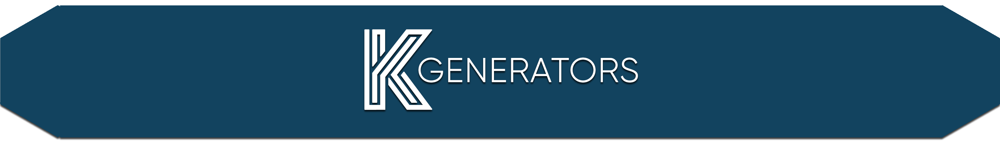
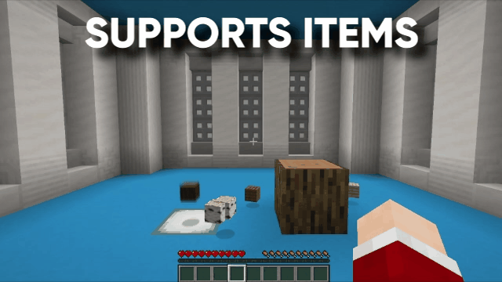
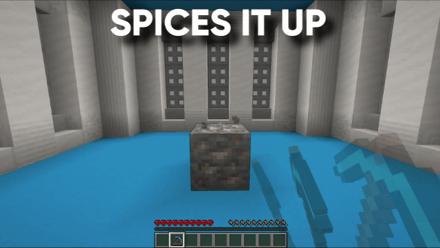

<p align="center">
 
</p>

<h1 align="center">KGenerators Regenerated</h1>

<p align="center">
  <a href="https://github.com/MaximumWoahverdrive/KGenerators/actions/workflows/gradle-build.yml"></a>
  <a href="https://github.com/MaximumWoahverdrive/KGenerators/releases"></a>
  
  
</p>

<p align="center">
  <b>Custom block generators for Paper and Folia, from Minecraft 1.19.4 to 26.x.</br>
  Skyblock, survival, prison or anywhere else: simple and multi-purpose.</b>
</p>

<p align="center">
 
 
 
</p>

## About

KGenerators Regenerated continues [KGenerators](https://github.com/Kryniowesegryderiusz/KGenerators)
by Kryniowesegryderiusz, which was archived in October 2025. The plugin name, commands,
permissions, configuration files, data folder and developer API are unchanged, so a server
running KGenerators 7.3 keeps its placed generators, generator items and settings when it switches
to KGenerators Regenerated. Version 8.0.0 does raise the requirements (see below) and changes a
few behaviours; the [migration notes](docs/migrating-to-8.0.md) list everything.

On top of the original it adds:

- **Folia** support
- **Minecraft 26.x** support
- Generators made of gravity blocks (sand, gravel, ...) no longer fall out of place
- **MiniMessage** formatting in messages, menus and items, alongside `&` colour codes
- Many bug fixes, listed in the migration notes

## Download

Get the latest jar from [Releases](https://github.com/MaximumWoahverdrive/KGenerators/releases)
and put it in your server's `plugins/` folder. It needs Paper 1.19.4 or newer, or a Paper fork
(Purpur, Folia, ...), on Java 17 or newer. For plain Spigot or older Minecraft versions, use
[7.3.1](https://github.com/MaximumWoahverdrive/KGenerators/releases/tag/7.3.1), which runs on
Spigot and Paper from 1.8.8.

Upgrading from KGenerators 7.3.x? Read [the 8.0.0 migration notes](docs/migrating-to-8.0.md) first.

## Documentation

See [docs/](docs/README.md): commands and permissions, configuration, limits, supported plugins
and the developer API.

## Support

Report bugs and ask questions in [GitHub issues](https://github.com/MaximumWoahverdrive/KGenerators/issues).

## Building

```sh
gradle build
```

The plugin jar is written to `build/libs/`. Gradle downloads the JDKs it needs. Test servers for
each supported version run with `gradle runPaper1_19_4`, ... `runPaper1_21_11`, `runServer`
(Paper 26.3) and `runFolia`.

## Credits and license

KGenerators was created by [Kryniowesegryderiusz](https://github.com/Kryniowesegryderiusz).
KGenerators Regenerated is maintained by [MaximumWoahverdrive](https://github.com/MaximumWoahverdrive).

Licensed under the [Eclipse Public License 2.0](LICENSE.md), as the original.
